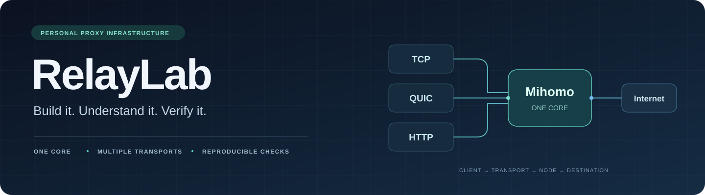
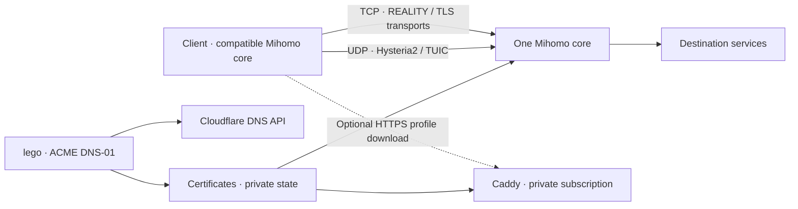

<p align="center">
  
</p>

<p align="center">
  <strong>English</strong> · <a href="README.zh-CN.md">简体中文</a> · <a href="README.ru.md">Русский</a>
</p>

<p align="center">
  <a href="versions.lock.json"></a>
  <a href="docs/ports.md"></a>
  <a href="LICENSE"></a>
</p>

# RelayLab

**Build a personal proxy node. Understand how it works. Test it before relying on it.**

RelayLab combines a deployment toolkit, an isolated network lab, and an engineering handbook. It runs **one Mihomo core in Docker Compose**, with **VLESS + RAW + REALITY** and **Hysteria2** enabled by default. Seven additional entries are available when you need them.

The initial resource budget is **1 vCPU / 1 GB RAM**. The fresh-host installer targets **Ubuntu 24.04 amd64**. The project started with a Japanese VPS, but the design does not require a particular region or cloud provider.

[Install on a new VPS](#install-on-a-new-vps) · [Try the local lab](#try-the-local-lab) · [Protocols and ports](#protocols-and-ports) · [Read the handbook](docs/training/README.md) · [Review the evidence](docs/evidence.md)

[October stability maintenance](docs/stability-20261031.md): core upgrade, a 30-second client fallback policy, explicit DNS routing, bounded resource monitoring, and measured recovery limits.

[Mobile connectivity follow-up](docs/mobile-connectivity-20261031.md): a seven-entry direct-TCP versus TUIC-path comparison, a separate profile for tested paths, Clash Mi settings, and a real packet-loss failover trial. The failed direct TCP paths remain unresolved; the mobile OS has not been tested.

## What you get

- **A reproducible deployment:** upstream images pinned by digest, separate lab and production Compose files, configuration validation, release-based updates, encrypted backups, and rollback tools.
- **A lab that checks actual connections:** forwarding, valid and invalid credentials, certificate verification, TCP/UDP behavior, restarts, version changes, and controlled network impairments.
- **Private client profiles:** manual selection, failover, or latency-based selection; an optional HTTPS subscription endpoint for profile downloads.
- **An engineering handbook:** 17 chapters covering the core, handshakes, protocols, DNS, certificates, measurement, reliability, and security, supported by committed experimental data.

These three homepages cover the same material. The detailed handbook and most operational guides are currently in **Chinese**.

## How it differs

| Approach | Its focus | RelayLab's focus |
|---|---|---|
| A standalone proxy core | Implementing protocols and forwarding traffic | Operating that core with deployment, validation, recovery, and documentation around it |
| A quick installation script | Getting a service running | A previewable plan, locked dependencies, private state, and a separate acceptance procedure |
| A commercial proxy platform | Subscriber accounts, billing, quotas, and fleet management | A personal node with private profiles and a small operational footprint |
| An IP tunnel such as WireGuard | Carrying IP packets through a tunnel | Application proxy transports; traffic capture and routing are configured in the client |

RelayLab uses upstream implementations of protocols and cryptography. It does not implement a new cipher, a TLS stack, or a proxy protocol. The optional reading website is documentation; the optional subscription endpoint serves profiles. Neither is a server administration panel.

## How it is built



| Component | Role | Version or deployment choice |
|---|---|---|
| **Mihomo** | Authenticates incoming connections and forwards traffic | `v1.19.33`, upstream `metacubex/mihomo` image pinned by digest |
| **Docker Compose** | Runs the core, separates environments, limits resources and logs | Linux containers; production IPv4 bridge/NAT |
| **Python** | Generates configuration and coordinates validation, releases, tests, and recovery | Python 3.12+ |
| **lego** | Issues and renews TLS certificates through ACME DNS-01 | `5.4.1`; Cloudflare provider in the fresh-host installer |
| **age** | Encrypts deployment backups | `1.3.2` |
| **Caddy** | Optionally serves private profiles over HTTPS | `2.11.4-alpine`, image pinned by digest |

The versions above are the repository's **locked baseline**, not a claim about the newest upstream releases. Checksums and image digests are recorded in [versions.lock.json](versions.lock.json).

The production core runs as UID `10001`, with a read-only filesystem, dropped capabilities, and no privileged mode. Its default limits are **512 MiB memory, one CPU, and 128 processes**; container logs rotate at **10 MiB × 3 files**. There is no public core management API. Secrets, certificates, generated profiles, and release state live outside the source tree.

Docker publishes ports through forwarding/NAT rules. Host `INPUT` rules alone are insufficient: review the cloud firewall and Docker forwarding policy, including `DOCKER-USER` for the iptables backend. A different backend needs its corresponding firewall procedure. See the [host guide](docs/server-setup.md) and [network layout](docs/ports.md).

## Protocols and ports

| Configuration ID | Entry | Public port | Default |
|---|---|---|---|
| `reality` | VLESS RAW/TCP + REALITY + Vision | TCP **443** | Enabled |
| `hy2` | Hysteria2 over QUIC | UDP **443** | Enabled |
| `anytls` | AnyTLS over TLS | TCP 8443 | Optional |
| `tuic` | TUIC v5 over QUIC | UDP 8443 | Optional |
| `trojan` | Trojan over TLS | TCP 9443 | Optional |
| `ss` | Shadowsocks, `chacha20-ietf-poly1305` | TCP + UDP 8388 | Optional |
| `xhttp` | VLESS XHTTP, `packet-up`, over TLS | TCP 10443 | Optional |
| `ws` | VLESS WebSocket over TLS | TCP 11443 | Optional |
| `grpc` | VLESS gRPC over TLS | TCP 12443 | Optional |

TCP 443 and UDP 443 are distinct listeners. Open only the ports for entries you enable. SSH access belongs to the host and should be restricted to your management sources. The optional subscription uses **TCP 2087**; DNS-01 certificate issuance does not require opening port 80. The [port guide](docs/ports.md) also lists internal container ports.

Each enabled entry needs its own connection test on the actual client. An application name or a successful configuration parse does not prove compatibility: record both the **application version and the embedded core version**.

## Try the local lab

You need Git, Python 3.12+, OpenSSL, Docker with Linux containers, and a Compose plugin supporting `up --wait`. Downloading the pinned images requires Internet access.

```bash
git clone https://github.com/wohuishuo/relay-lab.git
cd relay-lab
python3 scripts/manage.py doctor
python3 scripts/manage.py pull
python3 scripts/manage.py local-test --state /tmp/relay-lab-first-test --protocols reality hy2
```

Use a **new directory outside the repository** for each run. Omit `--protocols reality hy2` to test all nine entries. The client/probe and target are on separate internal Docker networks, connected through the proxy core; the lab publishes no host ports and does not contact your production node.

On Windows, run the commands from the cloned repository in PowerShell:

```powershell
$labState = Join-Path $env:LOCALAPPDATA ("RelayLab\lab-" + [guid]::NewGuid().ToString("N"))
python scripts/manage.py doctor
python scripts/manage.py pull
python scripts/manage.py local-test --state "$labState" --protocols reality hy2
```

Read [acceptance](docs/acceptance.md) and [evidence](docs/evidence.md) for what the checks establish and what still requires a real network.

## Install on a new VPS

The installer is for a **fresh Ubuntu 24.04 amd64 host**, using `/opt/relay-lab` for source and `/var/lib/relay-lab` for private state. It refuses to replace an existing deployment. Use the [release workflow](docs/server-setup.md) to maintain an installed node.

### 1. Prepare the host and access

Install Git, Python 3.12+, OpenSSL, CA certificates, and [Docker Engine with the Compose plugin](https://docs.docker.com/engine/install/ubuntu/). Create a DNS A record pointing to the VPS; use **DNS only** in Cloudflare for these direct entries. Add IPv6 only after you have tested it.

Keep a working recovery console and a second SSH session before changing SSH or firewall rules. Restrict SSH sources, allow the selected protocol ports, and check the Docker forwarding policy. The installer expects these prerequisites to be complete; it does not install Docker or change SSH/firewall rules.

### 2. Prepare source and private settings

```bash
sudo git clone https://github.com/wohuishuo/relay-lab.git /opt/relay-lab
cd /opt/relay-lab
sudo install -d -m 700 /var/lib/relay-lab
sudo install -m 600 templates/settings.example.json /var/lib/relay-lab/settings.json
sudo install -m 600 templates/cloudflare-credentials.example.json /var/lib/relay-lab/dns-credentials.json
```

Use an authenticated GitHub account if the repository is private. Review and record the source commit you install. Edit the two private files with a trusted editor: replace the example domain, choose the protocol IDs, set a REALITY target verified from the VPS, and provide a zone-scoped DNS API token. Follow the [Cloudflare provider requirements](https://go-acme.github.io/lego/dns/cloudflare/). Keep credentials in the file, rather than shell arguments or Git.

### 3. Preview, then deploy

```bash
sudo bash install.sh --settings /var/lib/relay-lab/settings.json
```

The default command validates settings and prints the plan. It does not pull images, request certificates, or deploy containers. After reviewing the plan and the [ACME terms](https://letsencrypt.org/repository/), apply it:

```bash
sudo bash install.sh \
  --settings /var/lib/relay-lab/settings.json \
  --email owner@example.com \
  --credentials /var/lib/relay-lab/dns-credentials.json \
  --apply --firewall-ready --recovery-ready --accept-acme-tos
```

Replace the contact email. The confirmation flags assert that you have completed the prerequisites; they do not configure them. The installer pulls pinned images, verifies downloaded tools, checks ACME staging before production issuance, prepares a private release, validates and starts it, exports a client profile, and enables certificate renewal. Any failed stage returns a nonzero exit status.

### 4. Import and verify

Securely transfer **`/var/lib/relay-lab/client.yaml`** to a compatible Mihomo client. Test each enabled entry, rejected credentials, forwarding, certificate verification where applicable, restart recovery, and update/rollback. Use the [acceptance checklist](docs/acceptance.md) to record results.

**Validation boundary:** committed reports cover dated local component and container tests. The complete fresh-cloud-host installation, live DNS API/production ACME flow, and device-specific acceptance still require verification on the target deployment. A healthy container is only one check. See the [full installation guide](docs/quickstart.md).

## Client profiles and automatic selection

The separate [compact stability profile](docs/stability-20261031.md#generate-the-compact-client-profile) uses `JP-STABLE → JP-AUTO`, 30-second probes and explicit DNS routing. Generate it with `scripts/export-stable.py`; the older bundle exporter below retains its 120-second defaults.

Profiles can use `manual`, `fallback`, or `url-test` mode. To export a failover profile from an existing release, replace `RELEASE_ID` and choose a new output file outside the repository:

```bash
sudo python3 scripts/export-bundle.py \
  --state /var/lib/relay-lab --release RELEASE_ID \
  --mode fallback --output /var/lib/relay-export/fallback.yaml
```

`fallback` follows the preferred order of reachable entries; `url-test` selects by measured latency. Checks default to **120 seconds**, with **50 ms tolerance** for latency selection. Selection happens in the client. It does not migrate existing connections between protocols, and several protocols on one VPS still share a single host failure point.

For a download link, enable the optional [private HTTPS subscription](docs/training/12-subscriptions.md). Treat the tokenized URL as a credential. Caddy serves the profile over verified TLS on TCP 2087; it has no exposed admin API, and unknown paths return 404. Subscription downloads update configuration; they are separate from runtime failover.

## Operate and recover

```bash
sudo python3 scripts/manage.py status --state /var/lib/relay-lab
sudo bash scripts/check-host.sh
sudo systemctl status relay-lab-renew.timer
```

The fresh-host installer schedules certificate checks twice daily. Certificates are loaded only when they change; loading can briefly interrupt connections. Monitor timer failures and certificate expiry as well as memory, disk, traffic, and bounded logs.

Before updates, keep an **age-encrypted backup**, save the decryption identity offline, and retain the previous release and image. Follow the [operations guide](docs/server-setup.md) for deployment, rollback, and restore, and the [reliability chapter](docs/training/15-reliability.md) for monitoring and recovery drills.

## Learn the system

| Learning path | Chapters |
|---|---|
| Follow a connection | [System](docs/training/01-system.md) · [Core](docs/training/02-core.md) · [Handshake](docs/training/03-handshake.md) |
| Understand the transports | [REALITY](docs/training/04-reality.md) · [Hysteria2](docs/training/05-hysteria2.md) · [TUIC](docs/training/06-tuic.md) · [TLS transports](docs/training/07-transports.md) · [Shadowsocks](docs/training/08-shadowsocks.md) |
| Deploy and distribute | [DNS](docs/training/09-dns.md) · [Certificates](docs/training/10-certificates.md) · [Deployment](docs/training/11-deployment.md) · [Subscriptions](docs/training/12-subscriptions.md) |
| Measure and maintain | [Performance](docs/training/13-performance.md) · [Measurement](docs/training/14-measurement.md) · [Reliability](docs/training/15-reliability.md) · [Security](docs/training/16-security.md) · [Commercialization](docs/training/17-commercial.md) |

Read on GitHub or [build the local reading website](docs/reading-site.md), with chapter navigation, search, theme switching, and experimental charts. For network-specific investigations, start with the [campus network guide](docs/campus-network.md). Local short-flow measurements explain mechanisms; they are not a ranking of public-network protocol speeds.

## Repository map

```text
jp/                    Configuration, certificates, releases, backups
scripts/               Installation, lifecycle, profile export, testing
compose.*.yaml         Production, subscription, isolated lab
templates/             Settings and credential placeholders
lab/                   Measurement and network impairment fixtures
tests/                 Unit and container regression tests
reports/               Sanitized results and verification records
docs/training/         17-chapter Chinese engineering handbook
versions.lock.json     Upstream versions, digests, and checksums
```

RelayLab is an independent project under the [MIT license](LICENSE). Upstream licenses are documented in [THIRD_PARTY.md](THIRD_PARTY.md); sensitive-data handling and reporting are covered in [SECURITY.md](SECURITY.md). It is not affiliated with Mihomo, Clash, Google, or a cloud provider. A single VPS does not provide multi-host high availability or guarantee 99.9999% uptime.
