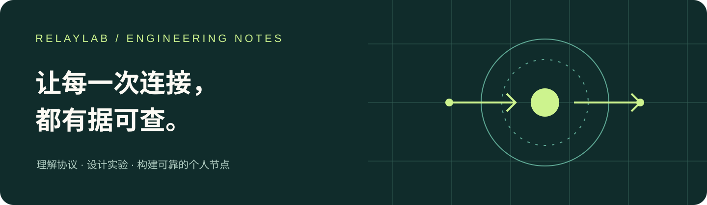

# RelayLab · 代理工程实验室

面向个人节点的可重复部署、隔离实验与中文技术课程。单个 Mihomo 核心，默认 REALITY + Hysteria2；九种入口分别验证，秘密与代码分离。

[开始学习](docs/training/README.md) · [安装向导](docs/quickstart.md) · [速度调查](docs/training/13-performance.md) · [测试证据](docs/evidence.md) · [安全边界](SECURITY.md)

## 能得到什么

- **部署工具**：本地/生产 Compose、固定镜像摘要、配置校验、证书续期、加密备份与回滚。
- **17 章课程**：从核心、握手、各协议、DNS API，到性能实验、稳定性、自动切换和商业化边界。
- **可运行实验**：正确与错误认证、TCP/UDP、TLS 负例、重启/版本切换，以及方向性延迟、丢包、限速。
- **离线客户端配置**：手选、故障回退、延迟优选；可选私有 HTTPS 订阅。不会自动修改已有客户端或服务器。
- **阅读站点**：响应式布局、全文筛选、章节导航、主题切换和实验图表；无统计追踪或外部字体。

## 先在本机体验

需要 Python 3.12+、OpenSSL、可运行 Linux 容器的 Docker 与 Compose plugin。Windows 命令中的 `python3` 换为 `python`。状态目录必须在仓库外。

```bash
python3 scripts/manage.py doctor
python3 scripts/manage.py pull
python3 scripts/manage.py local-test --state /tmp/relay-local-new --protocols reality hy2
```

扩展验收时省略 `--protocols`，将逐一验证九个入口。实验不发布宿主端口、不访问真实服务器。

## 新服务器安装

源码放在 `/opt/relay-lab`，安装 Docker 官方 Engine/Compose，准备域名、最小权限 DNS token 文件与恢复通道。先阅读[完整前提](docs/quickstart.md)，默认命令仅输出计划：

```bash
bash install.sh --settings /var/lib/relay-lab/settings.json
```

显式 `--apply` 才部署，要求 Ubuntu 24.04 amd64/root、新状态、确认云防火墙和恢复通道。已有服务器使用 release 流程；向导拒绝覆盖。**新机一键流程尚未在全新云主机端到端验收**，本地组件测试不替代它。

## 阅读网站

```bash
python3 -m venv .venv
.venv/bin/python -m pip install --require-hashes -r requirements-docs.txt
.venv/bin/python scripts/build-docs.py
python3 -m http.server 8765 --bind 127.0.0.1 --directory site
```

Windows 虚拟环境解释器为 `.venv/Scripts/python.exe`。浏览本机 `http://127.0.0.1:8765`；不要把整个源码或私有状态目录作为 Web 根目录。也可在 GitHub 直接阅读 Markdown。

## 证据与限制

本地九协议正负认证/转发与生命周期已验收；短流基线 54 次、方向实验 96 次传输均校验通过。报告保留原始样本，不能把虚拟网络的短流数字当成公网带宽排名。真实线路慢速、SS 生产 TCP 失败与设备端兼容性仍有未验证项。

本轮不连接、修改或压测正在使用的生产服务器。单台 VPS 不承诺 99.9999% 可用性。没有商业用户系统、收费面板或公开核心管理 API。

GitHub Actions [模板](ci/README.md)已提供，但当前登录缺少 workflow 权限，尚未启用云端 CI；本地验证报告与云端执行状态分别记录。

## 项目地图

```text
jp/                    配置、证书、发布、备份与订阅
scripts/               生命周期入口、安装、离线导出、测试
compose.*.yaml         生产 / 订阅 / 隔离实验
templates/             不含真实身份的模板
lab/                   受控测量与故障注入夹具
tests/                 单元与容器回归
reports/               脱敏实验数据与验证结果
docs/training/         中文课程
docs/assets/           自包含阅读站点样式与图形
versions.lock.json     上游版本与校验摘要
```

这是独立的教学与部署项目，不隶属于 Mihomo、Clash、Google 或任何云商。自有代码与文档的许可见 [LICENSE](LICENSE)；上游许可与命名要求见 [THIRD_PARTY.md](THIRD_PARTY.md)。
