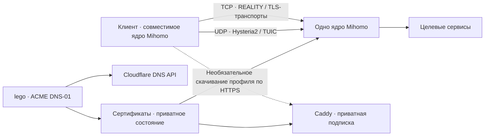

<p align="center">
  
</p>

<p align="center">
  <a href="README.md">English</a> · <a href="README.zh-CN.md">简体中文</a> · <strong>Русский</strong>
</p>

<p align="center">
  <a href="versions.lock.json"></a>
  <a href="docs/ports.md"></a>
  <a href="LICENSE"></a>
</p>

# RelayLab

**Разверните личный прокси, разберитесь в его устройстве и проверьте его перед использованием.**

RelayLab объединяет инструменты развёртывания, изолированную сетевую лабораторию и инженерное руководство. В **Docker Compose работает одно ядро Mihomo**. По умолчанию включены **VLESS + RAW + REALITY** и **Hysteria2**; ещё семь протокольных входов можно включить при необходимости.

Исходный бюджет ресурсов — **1 vCPU / 1 ГБ ОЗУ**. Установщик для нового сервера рассчитан на **Ubuntu 24.04 amd64**. Проект начинался с VPS в Японии, но архитектура не привязана к конкретному региону или облачному провайдеру.

[Установка на новый VPS](#установка-на-новый-vps) · [Локальная лаборатория](#локальная-лаборатория) · [Протоколы и порты](#протоколы-и-порты) · [Инженерное руководство](docs/training/README.md) · [Результаты проверок](docs/evidence.md)

## Что входит в проект

- **Воспроизводимое развёртывание:** образы разработчиков зафиксированы по digest, лабораторный и рабочий Compose разделены, есть проверка конфигурации, обновление через release, зашифрованные резервные копии и инструменты отката.
- **Проверка реальных соединений:** передача трафика, правильные и неправильные учётные данные, проверка сертификатов, TCP/UDP, перезапуски, смена версии и управляемые сетевые сбои.
- **Приватные клиентские профили:** ручной выбор, переключение при отказе или выбор по задержке; при необходимости — закрытая HTTPS-подписка для скачивания профиля.
- **Инженерные материалы:** 17 глав о ядре, рукопожатиях, протоколах, DNS, сертификатах, измерениях, надёжности и безопасности, с опубликованными в репозитории экспериментальными данными.

Три языковые версии главной страницы содержат одинаковый материал. Подробное руководство и большинство инструкций по эксплуатации пока доступны **на китайском языке**.

## Чем отличается от других подходов

| Подход | Основная задача | Задача RelayLab |
|---|---|---|
| Отдельное прокси-ядро | Реализация протоколов и передача трафика | Развёртывание, проверка, восстановление и документация вокруг ядра |
| Быстрый скрипт установки | Быстро запустить сервис | Предварительный план, фиксированные зависимости, приватное состояние и отдельная процедура приёмки |
| Коммерческая прокси-платформа | Аккаунты, оплата, квоты и управление парком серверов | Личный узел с приватными профилями и небольшим объёмом обслуживания |
| IP-туннель, например WireGuard | Передача IP-пакетов внутри туннеля | Прокси-транспорты для приложений; перехват трафика и маршрутизация настраиваются в клиенте |

Проект использует готовые реализации протоколов и криптографии. Он не создаёт собственный шифр, стек TLS или прокси-протокол. Дополнительный сайт предназначен для чтения документации, а сервис подписки — для скачивания профилей. Это не панели управления сервером.

## Технологии и архитектура



| Компонент | Назначение | Версия или способ развёртывания |
|---|---|---|
| **Mihomo** | Аутентификация входящих соединений и передача трафика | `v1.19.31`, образ разработчиков `metacubex/mihomo`, зафиксированный по digest |
| **Docker Compose** | Запуск ядра, разделение окружений, ограничения ресурсов и логов | Linux-контейнеры; в рабочей среде — IPv4 bridge/NAT |
| **Python** | Генерация конфигурации, проверки, релизы, тесты и восстановление | Python 3.12+ |
| **lego** | Выпуск и продление TLS-сертификатов через ACME DNS-01 | `5.4.1`; новый установщик использует провайдер Cloudflare |
| **age** | Шифрование резервных копий | `1.3.2` |
| **Caddy** | Необязательная выдача приватных профилей по HTTPS | `2.11.4-alpine`, образ зафиксирован по digest |

Это **зафиксированный набор версий** репозитория, а не список последних релизов. Полные digest и контрольные суммы находятся в [versions.lock.json](versions.lock.json).

Рабочее ядро запускается с UID `10001`, файловой системой только для чтения и без дополнительных capabilities или привилегированного режима. Лимиты по умолчанию: **512 МиБ памяти, один CPU и 128 процессов**; ротация контейнерных логов — **10 МиБ × 3 файла**. Публичного API управления ядром нет. Ключи, сертификаты, клиентские профили и состояние релизов хранятся вне каталога исходного кода.

Docker публикует порты через правила пересылки/NAT. Одних правил `INPUT` на хосте недостаточно: нужно проверить облачный firewall и правила пересылки Docker, включая `DOCKER-USER` для backend iptables. Для другого backend нужна соответствующая процедура. См. [руководство по серверу](docs/server-setup.md) и [схему сети](docs/ports.md).

## Протоколы и порты

| ID в конфигурации | Протокольный вход | Публичный порт | По умолчанию |
|---|---|---|---|
| `reality` | VLESS RAW/TCP + REALITY + Vision | TCP **443** | Включён |
| `hy2` | Hysteria2 / QUIC | UDP **443** | Включён |
| `anytls` | AnyTLS / TLS | TCP 8443 | По выбору |
| `tuic` | TUIC v5 / QUIC | UDP 8443 | По выбору |
| `trojan` | Trojan / TLS | TCP 9443 | По выбору |
| `ss` | Shadowsocks, `chacha20-ietf-poly1305` | TCP + UDP 8388 | По выбору |
| `xhttp` | VLESS XHTTP, `packet-up` / TLS | TCP 10443 | По выбору |
| `ws` | VLESS WebSocket / TLS | TCP 11443 | По выбору |
| `grpc` | VLESS gRPC / TLS | TCP 12443 | По выбору |

TCP 443 и UDP 443 — разные точки прослушивания. Открывайте только порты включённых входов. SSH — канал управления хостом; ограничьте доступ адресами администратора. Дополнительная подписка использует **TCP 2087**. Для DNS-01 не нужно открывать порт 80. [Таблица портов](docs/ports.md) также содержит внутренние порты контейнера.

Каждый включённый вход нужно отдельно проверить на реальном клиенте. Название приложения или успешный разбор конфигурации не доказывают совместимость: записывайте **версию приложения и версию встроенного ядра**.

## Локальная лаборатория

Нужны Git, Python 3.12+, OpenSSL, Docker с Linux-контейнерами и Compose plugin с поддержкой `up --wait`. Для скачивания фиксированных образов нужен доступ в Интернет.

```bash
git clone https://github.com/wohuishuo/relay-lab.git
cd relay-lab
python3 scripts/manage.py doctor
python3 scripts/manage.py pull
python3 scripts/manage.py local-test --state /tmp/relay-lab-first-test --protocols reality hy2
```

Для каждого запуска используйте **новый каталог вне репозитория**. Без `--protocols reality hy2` проверяются все девять входов. Клиент/проба и целевой сервис находятся в разных внутренних сетях Docker и соединяются через прокси-ядро. Лаборатория не публикует порты хоста и не обращается к рабочему узлу.

В Windows выполните команды в PowerShell из клонированного репозитория:

```powershell
$labState = Join-Path $env:LOCALAPPDATA ("RelayLab\lab-" + [guid]::NewGuid().ToString("N"))
python scripts/manage.py doctor
python scripts/manage.py pull
python scripts/manage.py local-test --state "$labState" --protocols reality hy2
```

[Процедура приёмки](docs/acceptance.md) и [результаты проверок](docs/evidence.md) объясняют, что подтверждают тесты и что ещё нужно проверить в реальной сети.

## Установка на новый VPS

Установщик рассчитан только на **новый сервер Ubuntu 24.04 amd64**. Исходный код должен находиться в `/opt/relay-lab`, приватное состояние — в `/var/lib/relay-lab`. Существующее развёртывание он не перезаписывает. Для установленного узла используйте [процедуру обновления через release](docs/server-setup.md).

### 1. Подготовьте хост и доступ

Установите Git, Python 3.12+, OpenSSL, корневые CA-сертификаты и [Docker Engine с Compose plugin](https://docs.docker.com/engine/install/ubuntu/). Создайте DNS-запись A с адресом VPS. Для этих прямых входов выберите в Cloudflare **DNS only**. Добавляйте IPv6 после его проверки.

Перед изменением SSH или firewall сохраните рабочую консоль восстановления и вторую SSH-сессию. Ограничьте источники SSH, откройте выбранные порты и проверьте пересылку Docker. Установщик требует готовых предпосылок; он не устанавливает Docker и не изменяет SSH/firewall.

### 2. Подготовьте код и приватные настройки

```bash
sudo git clone https://github.com/wohuishuo/relay-lab.git /opt/relay-lab
cd /opt/relay-lab
sudo install -d -m 700 /var/lib/relay-lab
sudo install -m 600 templates/settings.example.json /var/lib/relay-lab/settings.json
sudo install -m 600 templates/cloudflare-credentials.example.json /var/lib/relay-lab/dns-credentials.json
```

Для приватного репозитория нужен авторизованный аккаунт GitHub. Проверьте и запишите commit, который устанавливаете. Отредактируйте два приватных файла в доверенном редакторе: замените пример домена, выберите ID протоколов, укажите проверенную с VPS цель REALITY и DNS API token с правами только на нужную зону. Следуйте [документации провайдера Cloudflare](https://go-acme.github.io/lego/dns/cloudflare/). Храните секреты в файле, а не в аргументах команд или Git.

### 3. Проверьте план и запустите развёртывание

```bash
sudo bash install.sh --settings /var/lib/relay-lab/settings.json
```

Команда по умолчанию проверяет настройки и выводит план. Она не скачивает образы, не запрашивает сертификаты и не запускает контейнеры. После проверки плана и [условий ACME](https://letsencrypt.org/repository/) выполните:

```bash
sudo bash install.sh \
  --settings /var/lib/relay-lab/settings.json \
  --email owner@example.com \
  --credentials /var/lib/relay-lab/dns-credentials.json \
  --apply --firewall-ready --recovery-ready --accept-acme-tos
```

Замените контактный email. Флаги подтверждают, что предпосылки выполнены; сами они ничего не настраивают. Установщик скачивает фиксированные образы, проверяет загруженные инструменты, сначала проверяет ACME staging, затем получает рабочий сертификат, создаёт приватный release, проверяет и запускает его, экспортирует профиль и включает продление сертификатов. Любая ошибка завершает этап с ненулевым кодом возврата.

### 4. Импортируйте профиль и проверьте работу

Передайте **`/var/lib/relay-lab/client.yaml`** по защищённому каналу в совместимый клиент Mihomo. Проверьте каждый вход, отказ с неверными данными, передачу трафика, проверку сертификатов там, где она применяется, восстановление после перезапуска, обновление и откат. Запишите результаты по [контрольному списку](docs/acceptance.md).

**Границы проверки:** отчёты в репозитории фиксируют локальные тесты компонентов и контейнеров на указанные даты. Полная установка на новом облачном хосте, реальный DNS API/рабочий ACME и конкретные клиентские устройства требуют проверки на целевом развёртывании. Статус healthy у контейнера — лишь одна из проверок. Подробности — в [инструкции установки](docs/quickstart.md).

## Профили и автоматический выбор

Доступны режимы `manual`, `fallback` и `url-test`. Для экспорта профиля с переключением при отказе замените `RELEASE_ID` и укажите новый выходной файл вне репозитория:

```bash
sudo python3 scripts/export-bundle.py \
  --state /var/lib/relay-lab --release RELEASE_ID \
  --mode fallback --output /var/lib/relay-export/fallback.yaml
```

`fallback` выбирает доступный вход по заданному порядку; `url-test` — по измеренной задержке. Интервал проверок по умолчанию — **120 секунд**, допуск при выборе по задержке — **50 мс**. Выбор выполняется в клиенте. Уже установленные соединения не переносятся между протоколами, а несколько протоколов на одном VPS имеют общую точку отказа — хост.

Если нужна ссылка для скачивания, включите [приватную HTTPS-подписку](docs/training/12-subscriptions.md). URL с токеном является секретом. Caddy выдаёт профиль на TCP 2087 через TLS с обязательной проверкой сертификата, не открывает API администрирования и возвращает 404 для неизвестных путей. Загрузка подписки обновляет конфигурацию; переключение во время работы — отдельный механизм.

## Эксплуатация и восстановление

```bash
sudo python3 scripts/manage.py status --state /var/lib/relay-lab
sudo bash scripts/check-host.sh
sudo systemctl status relay-lab-renew.timer
```

Таймер нового установщика проверяет сертификат дважды в день. Перезагрузка сертификатов выполняется только при изменении и может кратковременно прервать соединения. Следите за ошибками таймера и сроком сертификата, а также за памятью, диском, трафиком и ограниченными по размеру логами.

Перед обновлением создайте **резервную копию, зашифрованную age**, сохраните ключ расшифрования офлайн и оставьте предыдущий release и образ. Развёртывание, откат и восстановление описаны в [руководстве по эксплуатации](docs/server-setup.md); мониторинг и учения по восстановлению — в [главе о надёжности](docs/training/15-reliability.md).

## Изучение системы

| Направление | Главы |
|---|---|
| Путь одного соединения | [Система](docs/training/01-system.md) · [Ядро](docs/training/02-core.md) · [Рукопожатие](docs/training/03-handshake.md) |
| Транспортные протоколы | [REALITY](docs/training/04-reality.md) · [Hysteria2](docs/training/05-hysteria2.md) · [TUIC](docs/training/06-tuic.md) · [TLS-транспорты](docs/training/07-transports.md) · [Shadowsocks](docs/training/08-shadowsocks.md) |
| Развёртывание и выдача профилей | [DNS](docs/training/09-dns.md) · [Сертификаты](docs/training/10-certificates.md) · [Развёртывание](docs/training/11-deployment.md) · [Подписки](docs/training/12-subscriptions.md) |
| Измерения и обслуживание | [Производительность](docs/training/13-performance.md) · [Измерения](docs/training/14-measurement.md) · [Надёжность](docs/training/15-reliability.md) · [Безопасность](docs/training/16-security.md) · [Коммерциализация](docs/training/17-commercial.md) |

Читайте на GitHub или [соберите локальный сайт](docs/reading-site.md) с навигацией по главам, поиском, сменой темы и графиками экспериментов. Для проблем конкретной сети начните с [руководства по сети кампуса](docs/campus-network.md). Короткие локальные передачи объясняют механизмы; они не являются рейтингом скоростей протоколов в Интернете.

## Структура репозитория

```text
jp/                    Конфигурация, сертификаты, релизы, резервные копии
scripts/               Установка, жизненный цикл, экспорт, тестирование
compose.*.yaml         Рабочая среда, подписка, изолированная лаборатория
templates/             Шаблоны настроек и учётных данных
lab/                   Измерения и моделирование сетевых сбоев
tests/                 Модульные и контейнерные регрессионные тесты
reports/               Обезличенные результаты и записи проверок
docs/training/         Инженерное руководство: 17 глав на китайском
versions.lock.json     Версии разработчиков, digest и контрольные суммы
```

RelayLab — независимый проект под [лицензией MIT](LICENSE). Лицензии зависимостей указаны в [THIRD_PARTY.md](THIRD_PARTY.md), работа с секретами и сообщения о проблемах — в [SECURITY.md](SECURITY.md). Проект не связан с Mihomo, Clash, Google или облачным провайдером. Один VPS не обеспечивает отказоустойчивость между хостами и не гарантирует доступность 99,9999%.
