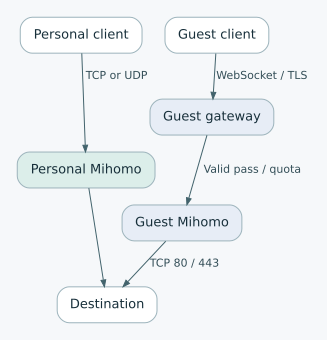

# Развёртывание личного прокси

Mihomo запускается на VPS с Ubuntu через Docker Compose. По умолчанию включены VLESS REALITY (TCP 443) и Hysteria2 (UDP 443). Дополнительно можно включить AnyTLS, TUIC v5, Trojan, Shadowsocks (SS, TCP/UDP 8388) и VLESS через XHTTP, WebSocket или gRPC.

Все девять вариантов подключения используют **семь номеров портов**: TCP 443, 8388, 8443, 9443, 10443, 11443 и 12443, а также UDP 443, 8388 и 8443. В одном из прежних развёртываний использовались также Shadowsocks с ShadowTLS и gRPC через Hysteria2. [Таблица портов и сведения о развёртывании](docs/ports.md)

[English](README.md) · [简体中文](README.zh-CN.md)

## Установка

1. Подготовьте новый сервер с Ubuntu 24.04 amd64, Docker Engine, плагином Compose, Git, Python 3.12 и OpenSSL. Направьте A-запись Cloudflare на VPS в режиме «Только DNS». Разрешите TCP 443 и UDP 443.
2. Клонируйте репозиторий в `/opt/relay-lab`. По [инструкции](docs/quickstart.md) скопируйте два файла настроек, укажите домен и учётные данные DNS, проверьте план установки.
3. Выполните установку. Импортируйте `/var/lib/relay-lab/client.yaml` в клиент с ядром Mihomo, выберите вход в группе `Relay` и проверьте соединение со своего устройства.

## Выбор протокола

По умолчанию вход выбирается вручную. Профиль `fallback` выбирает первый доступный вход по порядку, а `url-test` сравнивает задержку. Оба проверяют доступность каждые 120 секунд. При смене входа открытым соединениям может потребоваться переподключение. [Настройка переключения](docs/client-selection.md)

| Руководство на китайском | Содержание |
| --- | --- |
| [Протоколы и порты](docs/ports.md) | Девять вариантов подключения и требования к клиентам |
| [Архитектура](docs/architecture.md) | Путь запроса и компоненты сервера |
| [Обслуживание](docs/server-setup.md) | Обновление, продление сертификата, резервные копии и откат |
| [Гостевой доступ](docs/guest-portal.md) | Отдельные учётные данные, срок действия и лимит трафика |
| [Проверки](docs/evidence.md) | Испытания протоколов и переключения |

[Безопасность](SECURITY.md) · [Зависимости](THIRD_PARTY.md) · [Лицензия MIT](LICENSE)
