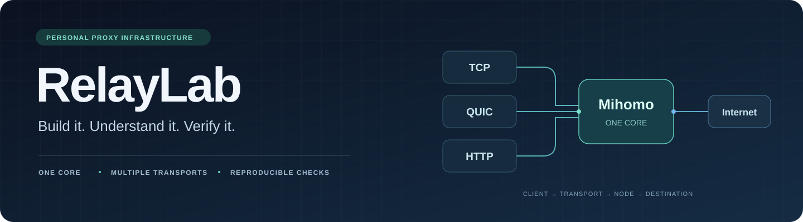
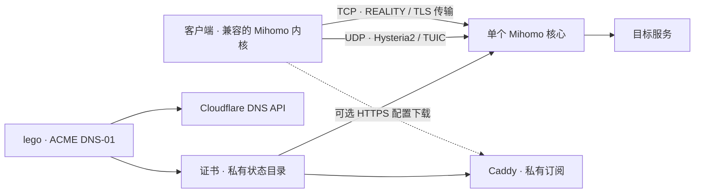

<p align="center">
  
</p>

<p align="center">
  <a href="README.md">English</a> · <strong>简体中文</strong> · <a href="README.ru.md">Русский</a>
</p>

<p align="center">
  <a href="versions.lock.json"></a>
  <a href="docs/ports.md"></a>
  <a href="LICENSE"></a>
</p>

# RelayLab

**搭建自己的代理节点，理解它的工作方式，用测试验证它是否可靠。**

RelayLab 把部署工具、隔离网络实验室和工程手册放在一个仓库中。它通过 **Docker Compose 运行单个 Mihomo 核心**，默认启用 **VLESS + RAW + REALITY** 和 **Hysteria2**，另外七种入口按需启用。

初始资源预算为 **1 vCPU / 1 GB 内存**，新机安装向导面向 **Ubuntu 24.04 amd64**。项目起步于日本 VPS，但设计不依赖特定地区或云厂商。

[安装到新 VPS](#安装到新-vps) · [先体验本地实验](#先体验本地实验) · [协议与端口](#协议与端口) · [阅读工程手册](docs/training/README.md) · [查看测试证据](docs/evidence.md)

[10 月稳定性维护记录](docs/stability-20261031.md)：内核升级、30 秒客户端故障切换策略、明确的 DNS 分流、容量受限的资源监测，以及实际测得的恢复时间。

[手机连接故障跟进](docs/mobile-connectivity-20261031.md)：7 个 TCP 入口的直连/TUIC 路径对照、独立日常订阅、Clash Mi 设置和真实丢包切换实验。失败的直连 TCP 路径尚未恢复，手机系统接管尚未实测。

[11 月节点连接修复](docs/entry-repair-20261101.md)记录了已发布的自有 TUIC/HY2 第一跳、原生 TCP 对照、逐入口认证转发和桌面热加载实测。

## 能得到什么

- **可重复的部署流程**：上游镜像固定摘要，本地与生产 Compose 分离，配置校验、按 release 更新、加密备份与回滚工具齐全。
- **验证真实连接的实验室**：检查转发、正确与错误凭据、证书验证、TCP/UDP、重启、版本切换，以及受控的网络故障。
- **私有客户端配置**：支持手动选择、故障回退或延迟优选；需要下载链接时，可启用私有 HTTPS 订阅入口。
- **工程学习材料**：17 章解释核心、握手、各协议、DNS、证书、测量、可靠性和安全，并附上已提交的实验数据。

三种语言的首页包含相同内容。深入工程手册和大部分操作指南目前为**中文**。

## 跟其他方案有什么区别

| 方案 | 主要解决什么 | RelayLab 的重点 |
|---|---|---|
| 单独使用代理核心 | 协议实现与流量转发 | 围绕核心补齐部署、验收、恢复和文档 |
| 快速安装脚本 | 尽快启动服务 | 可预览的部署计划、固定依赖、私有状态和独立验收流程 |
| 商业代理平台 | 用户账号、计费、配额和节点集群管理 | 面向个人节点，提供私有配置，控制运维规模 |
| WireGuard 等 IP 隧道 | 在隧道中传输 IP 数据包 | 使用应用代理传输；流量接管与路由由客户端配置 |

协议和加密均使用上游实现，项目不自创加密算法、TLS 栈或代理协议。可选阅读网站用于学习，可选订阅服务用于下载配置，两者都不是服务器管理面板。

## 技术架构



| 组件 | 职责 | 版本或部署方式 |
|---|---|---|
| **Mihomo** | 验证入口连接的身份并转发流量 | `v1.19.33`，上游 `metacubex/mihomo` 镜像固定摘要 |
| **Docker Compose** | 运行核心、隔离环境、限制资源和日志 | Linux 容器；生产使用 IPv4 bridge/NAT |
| **Python** | 生成配置，串联校验、发布、测试与恢复 | Python 3.12+ |
| **lego** | 通过 ACME DNS-01 申请和续期 TLS 证书 | `5.4.1`；新机向导使用 Cloudflare provider |
| **age** | 加密部署备份 | `1.3.2` |
| **Caddy** | 可选：通过 HTTPS 提供私有配置下载 | `2.11.4-alpine`，镜像固定摘要 |

这些版本是仓库的**固定基线**，不代表上游最新版本。完整校验和与镜像摘要见 [versions.lock.json](versions.lock.json)。

生产核心以 UID `10001` 运行，根文件系统只读，移除 capabilities，不启用特权模式。默认限制为 **512 MiB 内存、1 个 CPU、128 个进程**；容器日志按 **10 MiB × 3 个文件**轮转。不公开核心管理 API。密钥、证书、生成的客户端配置和 release 状态保存在源码目录之外。

Docker 通过转发/NAT 规则发布端口，仅设置宿主机 `INPUT` 规则不够。必须核对云防火墙与 Docker 转发策略；iptables backend 包括 `DOCKER-USER`，其他 backend 则按对应流程处理。参见[主机维护指南](docs/server-setup.md)和[网络布局](docs/ports.md)。

## 协议与端口

| 配置 ID | 入口 | 公网端口 | 默认状态 |
|---|---|---|---|
| `reality` | VLESS RAW/TCP + REALITY + Vision | TCP **443** | 启用 |
| `hy2` | Hysteria2 / QUIC | UDP **443** | 启用 |
| `anytls` | AnyTLS / TLS | TCP 8443 | 按需启用 |
| `tuic` | TUIC v5 / QUIC | UDP 8443 | 按需启用 |
| `trojan` | Trojan / TLS | TCP 9443 | 按需启用 |
| `ss` | Shadowsocks，`chacha20-ietf-poly1305` | TCP + UDP 8388 | 按需启用 |
| `xhttp` | VLESS XHTTP，`packet-up` / TLS | TCP 10443 | 按需启用 |
| `ws` | VLESS WebSocket / TLS | TCP 11443 | 按需启用 |
| `grpc` | VLESS gRPC / TLS | TCP 12443 | 按需启用 |

TCP 443 和 UDP 443 是不同的监听入口。只开放实际启用的端口；SSH 属于宿主机管理通道，应限制访问来源。可选订阅使用 **TCP 2087**；DNS-01 证书申请不需要开放 80。[端口手册](docs/ports.md)同时列出容器内部端口。

每个入口都要从实际客户端独立测试。知道应用名称、配置解析通过，都不能证明兼容：验收时应同时记录**应用版本与内置核心版本**。

## 先体验本地实验

需要 Git、Python 3.12+、OpenSSL、可运行 Linux 容器的 Docker，以及支持 `up --wait` 的 Compose plugin。首次下载固定镜像需要联网。

```bash
git clone https://github.com/wohuishuo/relay-lab.git
cd relay-lab
python3 scripts/manage.py doctor
python3 scripts/manage.py pull
python3 scripts/manage.py local-test --state /tmp/relay-lab-first-test --protocols reality hy2
```

每次使用**仓库外的新目录**。省略 `--protocols reality hy2` 可逐一测试九种入口。客户端/探针与目标位于两个不同的 Docker 内部网络，通过代理核心连接；实验不发布宿主端口，也不连接生产节点。

Windows 用户可在克隆后的仓库目录中使用 PowerShell：

```powershell
$labState = Join-Path $env:LOCALAPPDATA ("RelayLab\lab-" + [guid]::NewGuid().ToString("N"))
python scripts/manage.py doctor
python scripts/manage.py pull
python scripts/manage.py local-test --state "$labState" --protocols reality hy2
```

[验收清单](docs/acceptance.md)和[证据页](docs/evidence.md)说明了这些测试覆盖什么，以及哪些内容仍需在真实网络验证。

## 安装到新 VPS

向导只面向**全新 Ubuntu 24.04 amd64 主机**，源码固定在 `/opt/relay-lab`，私有状态固定在 `/var/lib/relay-lab`。它拒绝覆盖已有部署。已安装的节点按 [release 维护流程](docs/server-setup.md)更新。

### 1. 准备主机与管理通道

安装 Git、Python 3.12+、OpenSSL、CA 根证书，以及 [Docker Engine 和 Compose plugin](https://docs.docker.com/engine/install/ubuntu/)。添加指向 VPS 的域名 A 记录；这些直连入口在 Cloudflare 中选择 **DNS only**。IPv6 验证完成后再添加。

修改 SSH 或防火墙前，保留能使用的恢复控制台和第二条 SSH 会话。限制 SSH 来源，放行选定协议端口，并核对 Docker 转发策略。向导要求这些前提已经完成，不自动安装 Docker 或修改 SSH、防火墙。

### 2. 准备源码与私有设置

```bash
sudo git clone https://github.com/wohuishuo/relay-lab.git /opt/relay-lab
cd /opt/relay-lab
sudo install -d -m 700 /var/lib/relay-lab
sudo install -m 600 templates/settings.example.json /var/lib/relay-lab/settings.json
sudo install -m 600 templates/cloudflare-credentials.example.json /var/lib/relay-lab/dns-credentials.json
```

私有仓库需要使用已授权的 GitHub 账号。安装前审查并记录源码提交。用可信编辑器修改两个私有文件：替换示例域名，选择协议 ID，填写已从 VPS 验证的 REALITY 目标，以及限定 DNS zone 权限的 API token。按 [Cloudflare provider 文档](https://go-acme.github.io/lego/dns/cloudflare/)准备权限；凭据写入文件，不放进命令行或 Git。

### 3. 查看计划，再执行部署

```bash
sudo bash install.sh --settings /var/lib/relay-lab/settings.json
```

默认命令校验设置并打印计划，不拉取镜像、申请证书或启动容器。检查计划并阅读 [ACME 服务条款](https://letsencrypt.org/repository/)后执行：

```bash
sudo bash install.sh \
  --settings /var/lib/relay-lab/settings.json \
  --email owner@example.com \
  --credentials /var/lib/relay-lab/dns-credentials.json \
  --apply --firewall-ready --recovery-ready --accept-acme-tos
```

替换联系邮箱。确认参数表示你已完成前提，不会替你配置防火墙或恢复通道。向导按顺序拉取固定镜像、校验下载工具、先测试 ACME staging 再申请正式证书、生成私有 release、校验并启动、导出客户端配置、启用证书续期。任一阶段失败均返回非零状态。

### 4. 导入客户端并验收

通过安全通道将 **`/var/lib/relay-lab/client.yaml`** 传给兼容的 Mihomo 客户端。逐项验证每条入口、错误凭据拒绝、转发、适用入口的证书验证、重启恢复，以及更新/回滚。使用[验收清单](docs/acceptance.md)记录结果。

**验证范围：**仓库报告记录了特定日期的本地组件与容器测试。全新云主机的完整安装、真实 DNS API/正式 ACME 流程和具体设备兼容性，仍需在目标部署中验证。容器健康只是其中一项检查。完整前提见[安装指南](docs/quickstart.md)。

## 客户端配置与自动选择

新增的[精简稳定性配置](docs/stability-20261031.md#generate-the-compact-client-profile)使用 `JP-STABLE → JP-AUTO`、30 秒探测及明确的 DNS 分流。通过 `scripts/export-stable.py` 从已有配置生成；下方旧版 bundle 导出器仍保留 120 秒默认值。

支持 `manual`、`fallback`、`url-test` 三种模式。从已有 release 导出故障回退配置时，替换 `RELEASE_ID`，并指定仓库外的新输出文件：

```bash
sudo python3 scripts/export-bundle.py \
  --state /var/lib/relay-lab --release RELEASE_ID \
  --mode fallback --output /var/lib/relay-export/fallback.yaml
```

`fallback` 按顺序选择可用入口；`url-test` 根据测得的延迟选择。默认检查间隔为 **120 秒**，延迟优选的容差为 **50 ms**。选择发生在客户端，不迁移已经建立的连接；同一 VPS 上的多个协议仍然共享主机故障点。

需要下载链接时，按[私有 HTTPS 订阅教程](docs/training/12-subscriptions.md)启用服务。带 token 的 URL 就是凭据，应妥善保管。Caddy 在 TCP 2087 上通过需验证证书的 TLS 提供配置，不暴露管理 API，未知路径返回 404。订阅下载负责更新配置，与运行时自动切换是两件事。

## 日常维护与恢复

```bash
sudo python3 scripts/manage.py status --state /var/lib/relay-lab
sudo bash scripts/check-host.sh
sudo systemctl status relay-lab-renew.timer
```

新机向导安装的定时器每天检查证书两次，只在证书变化后加载；加载可能短暂中断连接。除内存、磁盘、流量和有限容量的日志外，还要监控定时器失败与证书到期。

更新前创建 **age 加密备份**，将解密身份离线保存，保留上一份 release 和镜像。部署、回滚、恢复见[维护指南](docs/server-setup.md)，监控和恢复演练见[可靠性章节](docs/training/15-reliability.md)。

## 学习整个系统

| 学习路径 | 章节 |
|---|---|
| 看懂一次连接 | [系统](docs/training/01-system.md) · [核心](docs/training/02-core.md) · [握手](docs/training/03-handshake.md) |
| 理解传输方式 | [REALITY](docs/training/04-reality.md) · [Hysteria2](docs/training/05-hysteria2.md) · [TUIC](docs/training/06-tuic.md) · [TLS 传输](docs/training/07-transports.md) · [Shadowsocks](docs/training/08-shadowsocks.md) |
| 部署与分发配置 | [DNS](docs/training/09-dns.md) · [证书](docs/training/10-certificates.md) · [部署](docs/training/11-deployment.md) · [订阅](docs/training/12-subscriptions.md) |
| 测量与持续运维 | [性能](docs/training/13-performance.md) · [测量](docs/training/14-measurement.md) · [可靠性](docs/training/15-reliability.md) · [安全](docs/training/16-security.md) · [商业化](docs/training/17-commercial.md) |

可以直接在 GitHub 阅读，也可以[构建本地阅读网站](docs/reading-site.md)，使用章节导航、搜索、主题切换和实验图表。调查特定网络时，先读[校园网诊断指南](docs/campus-network.md)。本地短流实验用于解释机制，不是公网协议速度排行榜。

## 仓库目录

```text
jp/                    配置、证书、release 与备份
scripts/               安装、生命周期、配置导出与测试
compose.*.yaml         生产、订阅与隔离实验环境
templates/             设置与凭据占位模板
lab/                   测量与网络故障夹具
tests/                 单元与容器回归测试
reports/               脱敏结果与验证记录
docs/training/         17 章中文工程手册
versions.lock.json     上游版本、镜像摘要与校验和
```

RelayLab 是采用 [MIT 许可](LICENSE)的独立项目。上游许可见 [THIRD_PARTY.md](THIRD_PARTY.md)，敏感信息处理与问题报告见 [SECURITY.md](SECURITY.md)。项目不隶属于 Mihomo、Clash、Google 或任何云厂商。单台 VPS 不提供跨主机高可用，也不保证 99.9999% 在线率。
