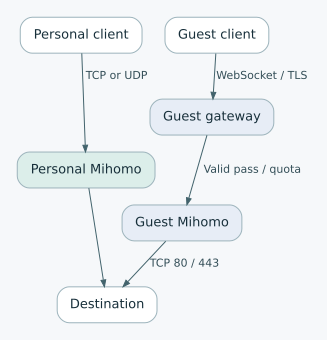

# 架构与连接生命周期

## 一次个人连接

1. 应用把请求交给设备上的 Mihomo。普通导出配置监听 `127.0.0.1:17890`，规则把请求交给 `Relay`。
2. 客户端使用手选入口或自动组当前选中的入口，与 VPS 对应的 TCP 或 UDP 端口建立连接。服务端核验该协议的凭据。
3. Compose 将已启用的端口映射到 Mihomo 容器。服务端规则拒绝配置中列出的本机及私有网段，其余请求从 VPS 连到目标。
4. 响应沿原连接返回。连接中断后，应用重新连接时可以使用自动组选中的另一个入口。

## 代码与运行文件

| 组件 | 职责 | 实现 |
| --- | --- | --- |
| 安装器 | 校验主机，申请证书，部署并导出客户端配置 | [jp/quickstart.py](../jp/quickstart.py) |
| 配置和部署 | 按协议生成配置、检查证书与监听、切换当前版本 | [jp/config.py](../jp/config.py) · [jp/operations.py](../jp/operations.py) |
| 个人代理 | Mihomo 负责认证、路由和转发，Compose 挂载配置与证书 | [compose.prod.yaml](../compose.prod.yaml) |
| 客户端 | 把已启用的协议组合成手选、按序备用或延迟选择组 | [jp/bundle.py](../jp/bundle.py) |
| 私有订阅（可选） | Caddy 通过 HTTPS 提供客户端配置文件 | [jp/subscription.py](../jp/subscription.py) |
| 访客服务（可选） | Django 保存账号、期限和额度，网关把授权流量交给独立的访客 Mihomo | [portal/gateway.py](../portal/gateway.py) · [访客部署](guest-portal.md) |

源码安装在 `/opt/relay-lab`。版本配置、证书、凭据和客户端导出保存在 `/var/lib/relay-lab`。访客实例有自己的数据库和密钥，可单独备份、停用。[部署生命周期与恢复](server-setup.md)
