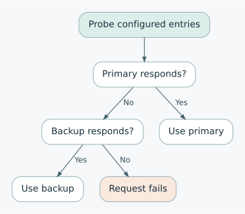

# 客户端自动切换

新安装导出的 `client.yaml` 使用 `manual`。要自动切换，先在服务器上生成一份新配置，再导入客户端。选择在设备上的 Mihomo 中执行，服务器无需重启。

| 导出模式 | 如何选择 | 适用场景 |
| --- | --- | --- |
| `manual` | 在 `Relay` 中手选一个入口，直到再次更改 | 单独验证某个协议 |
| `fallback` | 按配置顺序选第一个探测成功的入口，首选恢复后可重新使用 | 有明确首选，只想在失联时换线 |
| `url-test` | 比较探测 URL 的响应延迟，切换容差为 50 ms | 两个入口都可用，想优先低延迟 |



## 生成备用配置

在源码目录执行。命令读取当前部署 ID，在私有目录写入新文件。重复导出时换一个输出文件名。

```bash
cd /opt/relay-lab
state=/var/lib/relay-lab
release=$(sudo python3 -c 'import json,sys; print(json.load(open(sys.argv[1]))["current"])' "$state/active.json")
sudo python3 scripts/export-bundle.py --state "$state" --release "$release" \
  --mode fallback --output "$state/fallback.yaml"
```

导入 `fallback.yaml`，在 `Relay` 中选择 `Auto`。默认配置的顺序为 `reality`、`hy2`。要按延迟选择，把命令里的模式改为 `url-test`，输出改为新文件名。要临时固定协议，在同一组里点选协议名即可。

普通自动组每 120 秒通过各入口请求同一个 HTTPS 地址。可以用 `--health-url` 指定自己的 HTTPS 探测地址。切换影响之后建立的连接，正在进行的下载可能需要重连。探测延迟只反映该 URL 的响应时间。所有候选都失效时，普通配置的代理请求会失败；同一 VPS 上的多个入口也共享整机故障。

## 其他导出脚本

| 脚本 | 候选和选择方式 |
| --- | --- |
| [export-stable.py](../scripts/export-stable.py) | 读取 JSON 格式的客户端配置。按 HY2、TUIC、SS、Trojan、AnyTLS、原生 TCP VLESS 的顺序选可用独立入口。每 30 秒探测，超时 6 秒 |
| [export-mobile.py](../scripts/export-mobile.py) | 用重复的 `--candidate` 明确指定已在设备上测通的独立节点名。每 30 秒探测，要求 HTTP 204，超时 8 秒，延迟容差 150 ms |

这两个脚本各自输出一份新配置。局域网地址有单独的直连规则，`--direct-domain` 可添加直连域名。[普通配置生成器](../jp/bundle.py) · [设备策略](../jp/client_policy.py) · [本地切换测试](../reports/client-policy-local.json)

## 用私有订阅分发（可选）

准备好证书、域名和 TCP 2087 后，在服务器上执行以下命令。把 `node.example.com` 换成证书中的真实域名。

```bash
sudo python3 scripts/subscription.py prepare --state "$state" --client "$state/fallback.yaml" --domain node.example.com --bind 0.0.0.0 --port 2087
sudo python3 scripts/subscription.py deploy --state "$state"
sudo python3 scripts/subscription.py check --state "$state" --public
```

链接保存在 `subscription/url.txt`（相对于状态目录）。持有链接的人可以下载节点凭据。`publish --client` 更新配置，`rotate` 更换订阅链接。已下载的节点凭据需要单独轮换。
