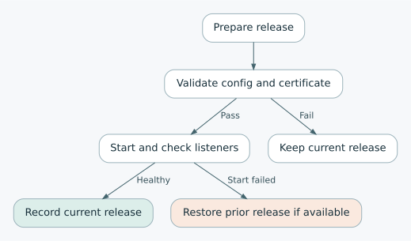

# 部署、更新与恢复



以下命令在 `/opt/relay-lab` 下执行。首次部署使用[安装指南](quickstart.md)。

## 查看当前状态

```bash
cd /opt/relay-lab
state=/var/lib/relay-lab
sudo python3 scripts/manage.py status --state "$state"
sudo cat "$state/active.json"
systemctl list-timers relay-lab-renew.timer
```

`current` 是当前版本，`previous` 是上次切换前的版本。证书、DNS 凭据和客户端配置均在仓库外。安装器生成的定时器每天检查两次续期，证书和私钥有变化时才停机更换并重启。加载失败时尝试恢复原证书。用 `journalctl -u relay-lab-renew.service` 查看结果。

## 更新

先备份，保留正在使用的镜像。在需要的版本上获取固定镜像，再用当前版本的凭据生成新配置。把下面的 `OLD_RELEASE_ID` 替换成 `current`，`NEW_RELEASE_ID` 替换成 `prepare` 输出的版本号。

```bash
sudo python3 scripts/manage.py pull
sudo python3 scripts/manage.py prepare --state "$state" --settings "$state/settings.json" --reuse-secrets-from OLD_RELEASE_ID
sudo python3 scripts/manage.py validate --state "$state" --release NEW_RELEASE_ID
sudo python3 scripts/manage.py deploy --state "$state" --release NEW_RELEASE_ID
```

`validate` 检查证书、Compose 和核心配置。`deploy` 校验后启动容器，等待监听健康检查，通过后才更新 `active.json`。从真实设备逐个测试已启用入口的 HTTPS、UDP、出口和认证。如果更改协议或凭据，重新导出客户端配置并在各设备导入。

## 回滚与故障恢复

| 情况 | 处理 |
| --- | --- |
| 新版本已成功启动，使用中需要退回 | 执行 `sudo python3 scripts/manage.py rollback --state "$state"`，部署 `previous` |
| 校验阶段报错 | 修正候选版本或证书。当前版本记录仍可用于定位运行中的配置 |
| 启动或健康检查失败 | 查看 `failed-deployment.json` 的 `recovery`。程序会尝试恢复被替换的版本；首次安装无可恢复版本时停止容器 |
| 恢复也失败 | 从独立管理通道检查服务。确认原版本有效后用 `deploy --release OLD_RELEASE_ID` 恢复 |

若需更换泄露的协议凭据，生成新版本时省略 `--reuse-secrets-from`，更新客户端，将使用旧凭据的版本 ID 加入状态目录内 `revoked-releases.json` 数组。被撤销的版本无法再次部署。

## 加密备份

用 age 在可信设备上生成密钥。服务器只需用于加密的公钥。恢复时在可信设备或主机上使用离线保存的私钥，输出目录必须尚未存在。

```bash
sudo python3 scripts/manage.py backup --state "$state" --recipient-file /root/recipient.txt --output /root/proxy-backup.age --age /opt/relay-lab-tools/age
sudo python3 scripts/manage.py restore --input /root/proxy-backup.age --identity /path/to/identity.txt --output /var/lib/relay-restored --age /opt/relay-lab-tools/age
```

备份包含版本、证书、ACME 账户、订阅和版本状态。另行保存 DNS 凭据、安装设置、续期配置和访客数据库。恢复后核对证书与版本，重新部署并测试。[备份文件范围](../jp/operations.py)
